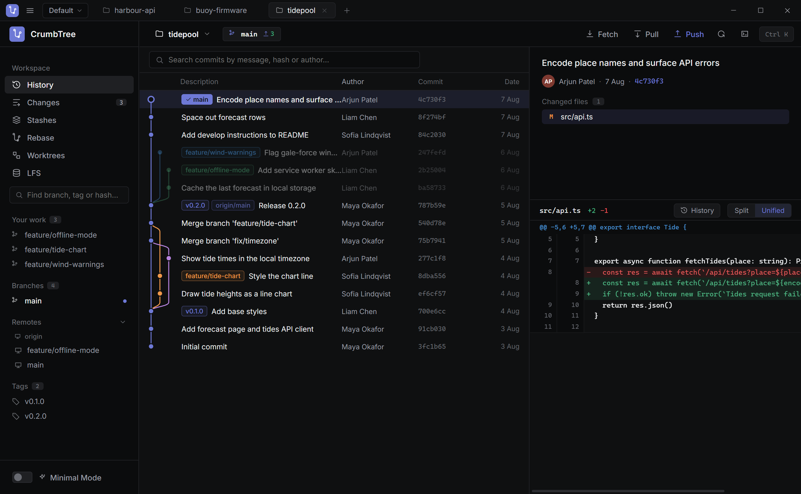
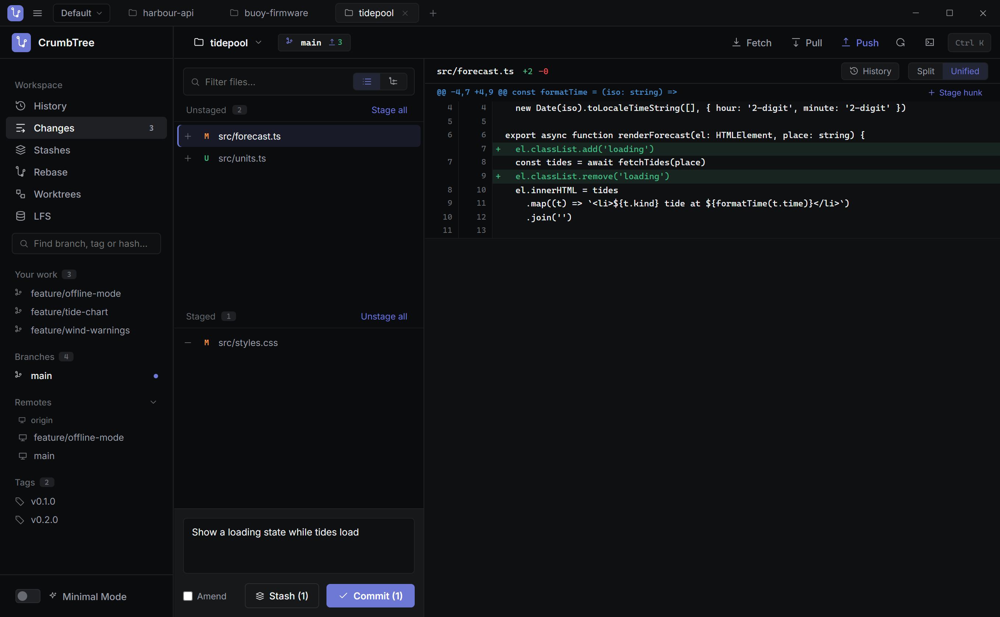
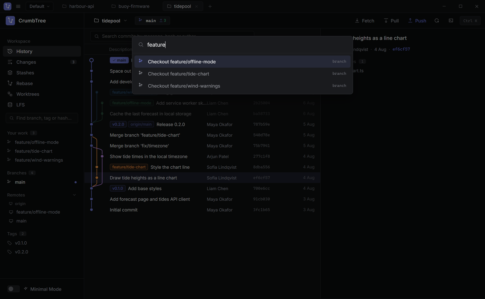
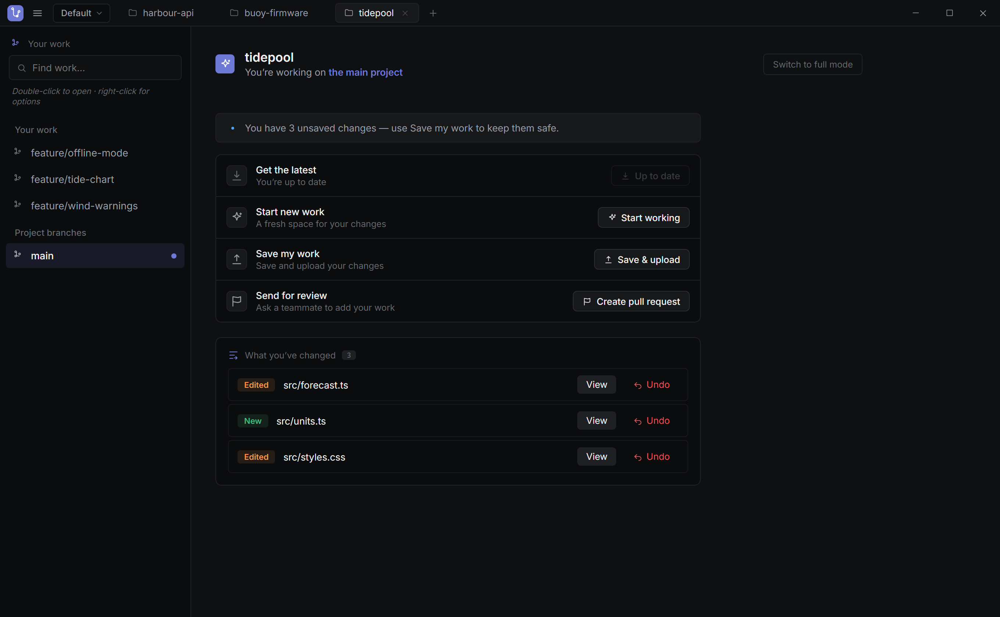

<p align="center">
  
</p>

<h1 align="center">CrumbTree</h1>

<p align="center">
  A desktop git client for Windows with a clear, vertical commit graph.
</p>

<p align="center">
  <a href="https://github.com/cookiester34/CrumbTree/releases/latest"></a>
  
  <a href="LICENSE.md"></a>
</p>

<p align="center">
  <a href="https://github.com/cookiester34/CrumbTree/releases/latest"><b>Download for Windows</b></a>
  &nbsp;·&nbsp;
  <a href="#features">Features</a>
  &nbsp;·&nbsp;
  <a href="#building-from-source">Build from source</a>
</p>

<br>



<br>

## Features

### See where you are

The branch you're on is highlighted and everything else fades back, so you can tell at
a glance what's in your history and what isn't. Click any commit to see what changed.

- Commit graph that stays fast on large repositories
- Search commits by message, hash or author
- Click a branch or tag to jump to its commit
- File history and blame for any file

### Commit with confidence



- Stage and unstage by file or by hunk
- Side-by-side or unified diffs
- Commit, amend and reword
- Fetch, pull and push, with ahead/behind counts

### Branch, merge and tidy up

- Create, rename, delete and switch branches from right-click menus
- Merge as a merge commit, squash, fast-forward or rebase
- Step through conflicts one chunk at a time and pick ours, theirs or both
- Interactive rebase with drag and drop (pick, reword, squash, fixup, drop)
- Stashes and worktrees

### Keyboard first



Press `Ctrl+K` to switch branches, pull, push or jump to any screen without touching the
mouse. There's also a built-in git terminal that shows every command CrumbTree runs.

### Minimal Mode



A simpler view for people who don't use git every day, such as artists and designers.
It swaps the full interface for a short list of plain-language actions: get the latest,
start new work, save my work, and send for review. It also lists what you've changed,
with a button to undo each change.

### And also

- Open several repositories as tabs
- Clone, or create a new repository locally and on GitHub
- Git LFS manager for adding and removing tracked patterns
- Open a repository from other tools with `crumbtree://open?path=<repo>`

## Install

1. Download `CrumbTree-Setup-x.y.z.exe` from the
   [latest release](https://github.com/cookiester34/CrumbTree/releases/latest).
2. Run it. The installer isn't code-signed yet, so Windows may show a SmartScreen
   warning. Click **More info**, then **Run anyway**.
3. Make sure [git](https://git-scm.com/downloads) is installed.

Git LFS and the GitHub CLI (`gh`) are optional. CrumbTree will tell you if a feature
needs one of them.

## Building from source

You'll need Node 18 or newer and git.

```bash
npm install
npm run dev     # run the app
npm test        # run the tests
npm run dist    # build the Windows installer into release/
```

`npm run demo` runs the interface in a normal browser with sample data, which is useful
for UI work. Open `/demo.html` at the address it prints.

CrumbTree is built with Electron, React and TypeScript. It runs your installed `git`
rather than a bundled copy, so it behaves the same as git on the command line.

## Licence

Free for non-commercial use under the
[PolyForm Noncommercial License 1.0.0](LICENSE.md). You can use, change and share it
for personal projects, study, hobbies, charities and schools. Selling it or using it
for commercial work requires permission.
